## Hi, I'm Ramu Maddirala

CS student at BITS Pilani (2028) and full-time supervisor of one extremely confident language model. I build backend-heavy, full-stack and AI-application systems, mostly by deciding what the AI is **not** allowed to touch.

**Stack:** `Java` `Python` `TypeScript` `React` `Spring Boot` `FastAPI` `Node.js` `PostgreSQL` `MongoDB` `WebSockets` `Docker`

**Receipts:** **1,600+ DSA problems solved**, which turns out to be great training for explaining to a computer that "probably correct" is not a return type.

**Open to:** SDE, FDE and applied AI roles.

> *The model may suggest. The code decides. The logs remember.*

[LinkedIn](https://www.linkedin.com/in/r7mu) &nbsp;·&nbsp; [Email](mailto:ramu7maddirala@gmail.com) &nbsp;·&nbsp; [SETU.ai](https://github.com/Ramu-9/Sethu) &nbsp;·&nbsp; [SmartKart](https://github.com/Ramu-9/SmartKart) &nbsp;·&nbsp; [PitchIQ](https://github.com/Ramu-9/PitchIQ)

---

## Case studies: three times the intern got overruled

### Case file 01: SETU.ai

**TL;DR / What actually happened:** The intern was mid-sentence when the caller interrupted, as callers do. The audio stopped before the intern could finish the word. Then I made it show receipts for every fact it claimed to have heard.

**[SETU.ai](https://github.com/Ramu-9/Sethu)** is a real-time, multilingual voice prototype for emergency coordination: **7 languages**, code-mixed speech included, and an LLM treated strictly as an untrusted parser.

| The intern wanted to | The code said |
|---|---|
| Keep talking over the caller | Playback stops locally in **0.2–1.5 ms** (measured in the test suite) |
| Remember a landmark because it "felt right" | Every fact must cite the **utterance it came from**. No source, no fact |
| Quietly tidy the incident log | **Append-only audit log**, enforced by a PostgreSQL trigger that blocks UPDATE and DELETE |
| Pick the responding unit by vibes | Dispatch is **deterministic Python** (Haversine nearest-unit), never LLM-chosen |
| Panic when the API rate-limits | A deterministic 7-language fallback keeps the session alive |

- **Browser audio:** `AudioWorklet` at 16 kHz with a 1.5 s pre-roll buffer, so the first syllable is never clipped. **Silero VAD** runs in WebAssembly
- **Pipeline:** React 19 + TypeScript, a Node.js WebSocket gateway, Python **FastAPI + asyncio**, **PostgreSQL + PostGIS + pg_trgm**
- **Numbers from the repo:** compact provenance prompting cut prompt tokens **46%** over a 12-turn test call (4,288 vs 7,940), and the repo ships **77 automated tests** (68 Python, 9 TypeScript)

[Read the code](https://github.com/Ramu-9/Sethu) &nbsp;·&nbsp; [Open the live preview](https://ais-pre-3gbhjctjktnswx6fxkrs7c-123461625038.asia-east1.run.app)

Research prototype. Not connected to India's 112 or any emergency service. Vehicles, routes and ETAs are simulated.

 

### Case file 02: SmartKart

**TL;DR / What actually happened:** The intern offered 50% off to anyone who seemed nice. The server hashed the cart, did the math, and said 15%. Then you edit one item and the discount quietly expires.

**[SmartKart](https://github.com/Ramu-9/SmartKart)** is an e-commerce platform for people who have a goal and a budget instead of a SKU. Type "quiet work-from-home desk under ₹15,000", get an editable bundle.

| The intern wanted to | The code said |
|---|---|
| Hand out 50% off | Hard cap of **15%**, enforced on the server and bound to a **SHA-256 cart hash** |
| Stuff your cart with "helpful" extras | Proposals live in a scratchpad. Nothing hits the cart until **you click add** |
| Declare the payment "looks fine" | Razorpay signatures verified with **HMAC-SHA256**, with replay protection |
| Take the day off when Gemini is down | **Deterministic fallback** keeps every AI feature working |

- **Stack:** React 19, Vite, Node.js, **Express 5**, MongoDB + Mongoose, JWT auth
- **AI layer:** Gemini structured outputs, validated against the real catalogue before anything reaches you
- **Smart Purchase Check:** reviews your cart and offers one-click swaps

[Read the code](https://github.com/Ramu-9/SmartKart) &nbsp;·&nbsp; [Try the live demo](https://smartkart-ai.vercel.app)

 

### Case file 03: PitchIQ

**TL;DR / What actually happened:** The intern wanted to call the match on vibes. Instead, a Java engine played it out 10,000 times, and the intern got reassigned to commentary.

**[PitchIQ](https://github.com/Ramu-9/PitchIQ)** is a cricket analytics platform built around a **Java 21 Monte Carlo engine**. Gemini only explains finished numbers. It never guesses the score.

| The intern wanted to | The code said |
|---|---|
| Predict the winner from vibes | **10,000 simulated endings** per match state |
| Pick outcomes with a slow linear scan | Weighted sampling on a `TreeMap` / `NavigableMap`: **O(log N)** per pick |
| Allocate objects like it's free | A mutable `MatchState` keeps allocations flat inside the loop |
| Wire itself into the core logic | Clean Architecture: the engine has **zero Spring dependencies** |

- **Backend:** Java 21, Spring Boot, Spring Data JPA, MySQL in production, H2 locally
- **Frontend:** vanilla JavaScript + Chart.js, no framework
- **Probabilities:** calibrated from historical ball-by-ball data through a CSV pipeline

[Read the code](https://github.com/Ramu-9/PitchIQ) &nbsp;·&nbsp; [Watch it play](https://pitchiq-ai.vercel.app)

---

## The employee handbook

| The intern may | The intern may not |
|---|---|
| Narrate a match from numbers the engine already computed | Predict the score |
| Propose a shopping bundle and ask for a discount | Add to the cart without approval, or exceed the 15% cap |
| Extract facts from a caller's words, with citations | Choose which unit gets dispatched, or edit the audit log |
| Be rate-limited and take the afternoon off | Take the product down with it (a deterministic fallback covers the shift) |

---

## Reviewer's notes & developer FAQ

> **My loop:** Build → Break → Read logs → Fix → Add a test → Accidentally find another edge case.

| Honest question | Honest answer |
|---|---|
| Do you trust LLM output? | "Cool. Where's the validation?" Schemas, source citations and server-side checks come first. Trust comes later, if at all. |
| What's your debugging style? | Follow the data, not the blame. Read the logs first, form opinions second. |
| The API returned 200. Done? | Pending proof that the actual workflow succeeded. |
| What happens when Gemini is down? | A deterministic fallback takes over, in both SmartKart and SETU.ai. The demo does not get to cry. |
| Why simulate a match instead of asking the model who wins? | 10,000 endings give you a distribution. An LLM gives you a confident vibe. |
| Do you use AI to write code? | Yes. It's a copilot, and it doesn't get automatic merge approval. |
| Biggest weakness? | Says "done", then finds three more edge cases. |

 

**Got a messy problem worth solving? That's usually where I start having fun.**

[Email me](mailto:ramu7maddirala@gmail.com) &nbsp;·&nbsp; [LinkedIn](https://www.linkedin.com/in/r7mu)

