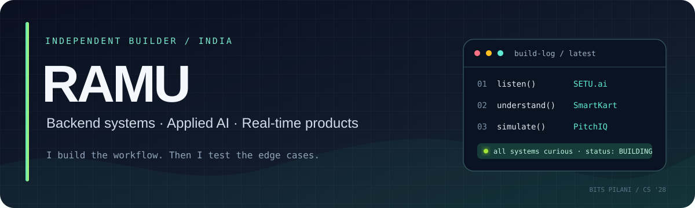

 

---

### The human behind the commits

I'm Ramu, a Computer Science student at BITS Pilani (2028). I like building software where several things have to work together: services, data, users, APIs, and occasionally my last remaining brain cell.

I move between backend engineering, applied AI and full-stack product work. I especially enjoy taking a vague problem, finding the actual moving parts, and making the whole workflow behave.

**Current loadout:** Java · Python · TypeScript · React · Spring Boot · Node.js · FastAPI · SQL

- 🧠 1,600+ DSA problems solved on InterviewBit
- 🧪 AI is my copilot. It does not get merge approval automatically.
- 🔍 Interested in agentic workflows, real-time systems, integrations and reliability.
- ☕ Debugging status: depends on how recently the logs were opened.

> **Personal engineering loop:** Build → Break → Read logs → Fix → Add a test → Accidentally find another edge case.

---

## Three projects. Three different rabbit holes.

<table>
<tr>
<td width="50%" valign="top">

### 🌉 SETU.ai
**A voice pipeline with a coordination problem to solve.**

A multilingual, real-time voice coordination prototype. It connects browser audio, speech services, AI reasoning and backend orchestration into one workflow.

**Under the hood**
- 7-language speech workflow
- React 19 + TypeScript
- Node.js WebSocket gateway
- Python FastAPI + asyncio
- Silero VAD + ONNX Runtime WebAssembly
- Gemini structured reasoning
- PostgreSQL + PostGIS
- Pre-roll buffering, interruption handling, deduplication, deterministic fallback and audit events

Research prototype only. Not connected to India's official 112 service; fleet, dispatch and ETA data are simulated.
</td>
<td width="50%" valign="top">

### 🛒 SmartKart
**Shopping by intent, not by SKU memory.**

An AI-powered commerce platform that turns a user's goal and budget into an editable shopping bundle, then helps check the cart before checkout.

**Under the hood**
- React 19 + Node.js + Express 5
- MongoDB + Mongoose
- Gemini structured outputs
- Deterministic recommendation fallback
- User approval before cart mutation
- Smart Purchase Check + contextual cross-sell
- Server-enforced discount rules
- Razorpay HMAC-SHA256 verification + replay protection

</td>
</tr>
<tr>
<td colspan="2">

### 🏏 PitchIQ
**10,000 possible match stories. One probability engine.**

A cricket analytics platform powered by a Java 21 Monte Carlo simulation engine. It runs 10,000 iterations per match state and keeps AI commentary grounded in deterministic results.

**Under the hood**
- Java 21 + Spring Boot + Spring Data JPA
- TreeMap / NavigableMap weighted sampling
- Match-data integration
- CSV probability-calibration pipeline
- Gemini commentary bounded by simulation outputs

</td>
</tr>
</table>

---

## The workbench

---

## Engineering principles (currently non-negotiable)

| Situation | My default reaction |
|---|---|
| LLM returns a confident answer | "Cool. Where's the validation?" |
| API returns 200 | Check whether the actual workflow succeeded. |
| Bug crosses three services | Follow the data, not the blame. |
| Feature works only on the happy path | Congratulations, you've met the demo. Now test it. |
| README needs an update | Apparently, today is that day. |

### Current terminal output

**Have a messy problem worth solving? That's usually where I start having fun.**

<a href="mailto:ramu7maddirala@gmail.com">ramu7maddirala@gmail.com</a>

