  

**Ramu Maddirala.** Computer Science student at BITS Pilani (2028). I build backend-heavy, full-stack and AI-powered systems, and I'm interested in SDE, backend, full-stack and applied AI roles.

`Java` `Python` `TypeScript` `Spring Boot` `FastAPI` `Node.js` `React` `PostgreSQL / PostGIS` `MongoDB` `WebSockets` `Docker`
&nbsp;·&nbsp; 1,600+ DSA problems solved

[LinkedIn](https://www.linkedin.com/in/r7mu) &nbsp;·&nbsp; [Email](mailto:ramu7maddirala@gmail.com) &nbsp;·&nbsp; [GitHub](https://github.com/Ramu-9)

---

## Meet the intern

Every project below has an LLM in it. I treat it like a very fast intern: wonderful at first drafts, with no reliable sense of when it is wrong.

So in each system the model is allowed to **propose**. Plain code (validated, capped, logged, tested) **decides**. Three case files, three times the intern got overruled.

 

## Case file 01: the intern listens, the audit log remembers

**[SETU.ai](https://github.com/Ramu-9/Sethu)** (*Setu* means bridge) is a real-time, multilingual voice coordination prototype for high-stress workflows. It connects browser audio, streaming speech services, AI reasoning and a deterministic Python orchestrator.

- Browser audio runs through an `AudioWorklet` at 16 kHz with a 1.5-second pre-roll buffer to preserve recent audio around speech onset; Silero VAD runs in WebAssembly
- Barge-in: when the caller interrupts, local playback stops in 0.2 to 1.5 ms in measured test conditions
- Every fact extracted by the LLM must cite the utterance it came from. Revised statements are recorded as contradictions
- Dispatch decisions are deterministic, never LLM-chosen, and the audit log is append-only, enforced by a PostgreSQL trigger
- If the LLM times out or gets rate-limited, a deterministic seven-language fallback keeps the session alive

[Read the code](https://github.com/Ramu-9/Sethu) &nbsp;·&nbsp; [Open the preview](https://ais-pre-3gbhjctjktnswx6fxkrs7c-123461625038.asia-east1.run.app)

Open the case file (stack and engineering notes)

 

React 19 + TypeScript, Node.js WebSocket gateway, Python FastAPI + asyncio, Gemini structured reasoning, PostgreSQL + PostGIS + pg_trgm. Compact provenance prompting reduced prompt tokens by 46% over a 12-turn test call (4,288 vs 7,940). The repository documents 77 automated tests (68 Python, 9 TypeScript).

Research prototype. Not connected to India's 112 system or any emergency service. Vehicles, depots, assignments, routes, hospitals and ETAs are simulated.

 

## Case file 02: the intern suggests, the server signs the receipt

**[SmartKart](https://github.com/Ramu-9/SmartKart)** is an e-commerce platform for people who have a goal and a budget instead of a SKU. Type "quiet work-from-home desk under ₹15,000", get an editable bundle, and nothing touches your cart until you approve it.

- Discount negotiation is hard-capped at 15% on the server and bound to a SHA-256 hash of the cart. Change the cart and the offer is invalidated
- Smart Purchase Check reviews cart items and suggests alternatives
- Razorpay payments use server-side HMAC-SHA256 verification and replay protection
- Gemini returns structured output, while a deterministic fallback handles unavailable or unreliable model responses

[Read the code](https://github.com/Ramu-9/SmartKart) &nbsp;·&nbsp; [Try it](https://smartkart-ai.vercel.app)

Open the case file (stack)

 

React 19, Vite, Node.js, Express 5, MongoDB + Mongoose, JWT authentication, Razorpay, Gemini structured outputs and a deterministic commerce fallback engine.

 

## Case file 03: the intern narrates, the math decides

**[PitchIQ](https://github.com/Ramu-9/PitchIQ)** is a cricket analytics platform. A Java 21 Monte Carlo engine plays out 10,000 possible endings for a match state, and Gemini writes commentary about the computed numbers. It never guesses the score.

- Weighted sampling on a `TreeMap` / `NavigableMap`, making each selection O(log N)
- A mutable `MatchState` keeps allocations flat inside the simulation loop
- Clean Architecture: the simulation engine has zero Spring dependencies
- Win probabilities use historical ball-by-ball data through a CSV calibration pipeline

[Read the code](https://github.com/Ramu-9/PitchIQ) &nbsp;·&nbsp; [Watch it play](https://pitchiq-ai.vercel.app)

Open the case file (stack)

 

Java 21, Spring Boot, Spring Data JPA, MySQL (production) / H2 (local), vanilla JavaScript + Chart.js frontend, and Gemini for the narration layer only.

 

## Employee handbook (excerpt)

| The intern may | The intern may not |
|---|---|
| Narrate a match from numbers the engine already computed | Predict the score |
| Propose a shopping bundle and ask for a discount | Add to the cart without approval, or exceed the 15% cap |
| Extract facts from a caller's words, with citations | Choose which unit gets dispatched, or edit the audit log |

 

## Reviewer's notes

I like software where several moving parts have to agree: services, data, users, APIs, and occasionally my last remaining brain cell. Give me a vague problem and I'll go looking for the actual moving parts.

> **My loop:** Build → Break → Read logs → Fix → Add a test → Accidentally find another edge case.

Performance review of the reviewer (optional)

 

- **Debugging status:** depends on how recently the logs were opened.
- **Trust in an LLM answer:** "Cool. Where's the validation?"
- **Trust in an API that returned 200:** pending proof that the workflow actually succeeded.
- **Known weakness:** says "done", then finds three more edge cases.

 

  

  **Got a messy problem worth solving? That's usually where I start having fun.**

  [Email me](mailto:ramu7maddirala@gmail.com) &nbsp;·&nbsp; [LinkedIn](https://www.linkedin.com/in/r7mu)

